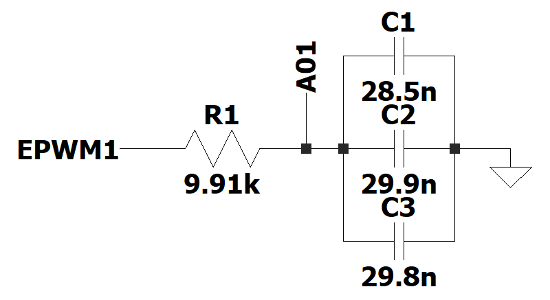
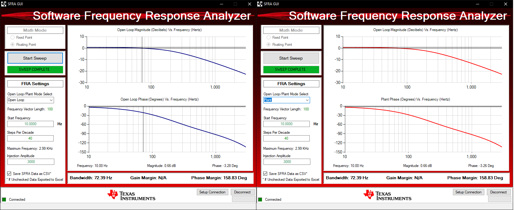
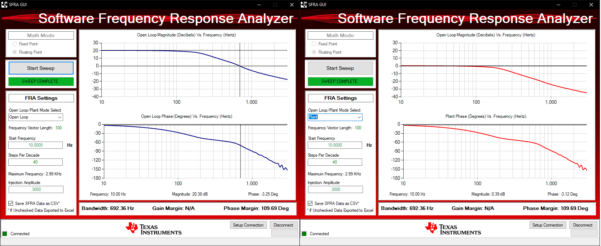
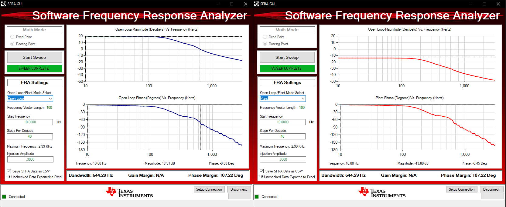
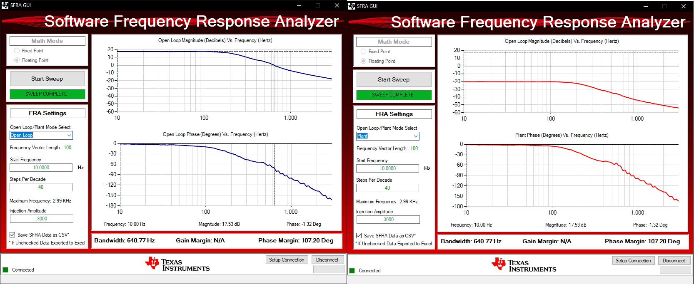

Esquemática

Teste 2 - Ver o comportamento dos gráficos de Open Loop e Plant no SFRA com uma constante multiplicando o duty no novo case criado chamado SFRA_K.
COMPORTAMENTO ESPERADO: Deslocamento do gráfico de Open Loop e gráfico da planta fica intacto com mudanças de valores de CTE_K.

Para CTE_K:
CTE_K=1:

CTE_K=10:

CTE_K=50:

CTE_K=100:  
Com injection amplitude=0.3:

Com injection amplitude=0.01:

