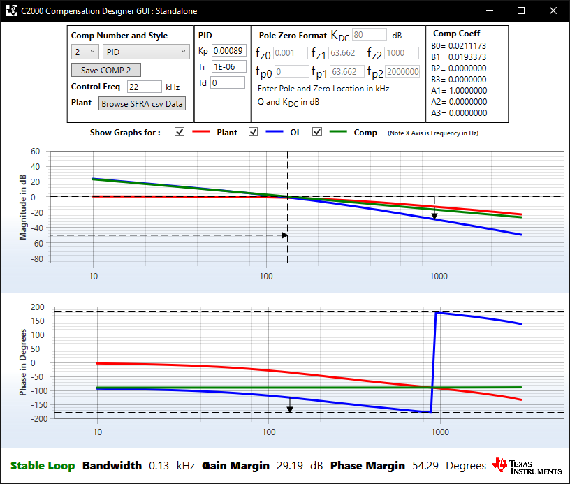
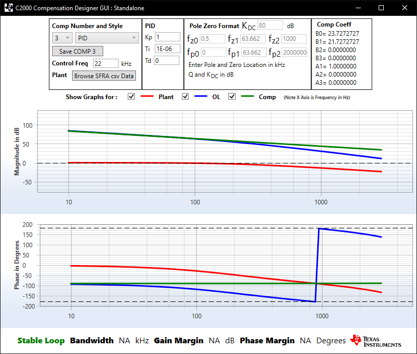

# Utilizando CompDesigner.exe

Serão utilizados os dados .csv gerados no Teste 1 pelo SFRA e o arquivo comp.xml proporcionado pelo professor.

## comp.xml

O arquivo contém 5 controladores diferentes. Iremos utilizar os 3 primeiros por serem controladores PI, evidenciados pelo valor de Td = 0.

### Controlador 1

### Controlador 2

### Controlador 3

